

<!-- ==================== DEHA.SYS // HERO TERMINAL HUD ==================== -->
<a href="https://dehaclk.com.tr">
  
</a>

 

<!-- ==================== SYSTEM UPLINK BAR ==================== -->

  
  
  
  
  

 

<!-- ==================== 01 // IDENTITY NODE ==================== -->
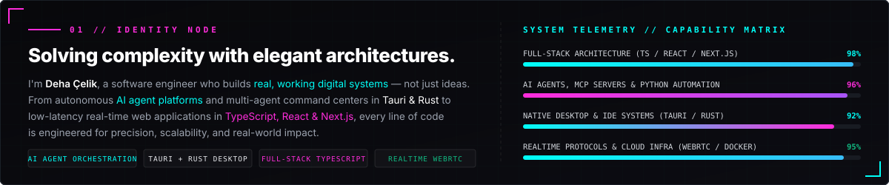

  

<!-- ==================== 02 // PROJECT ARCHIVE (HUD BENTO GRID) ==================== -->
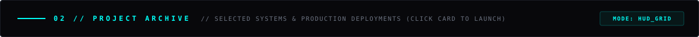

  <a href="https://dehaclk.com.tr">
    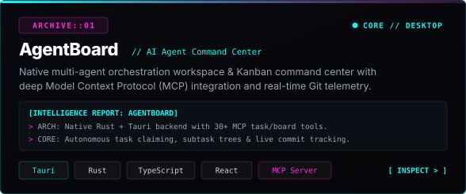
  </a>
  <a href="https://dehaclk.com.tr">
    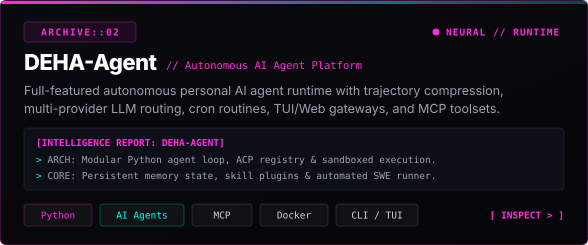
  </a>

  <a href="https://privia-new-web.vercel.app">
    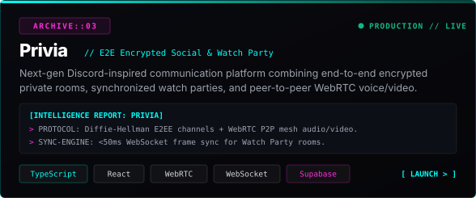
  </a>
  <a href="https://unitrack-pearl.vercel.app">
    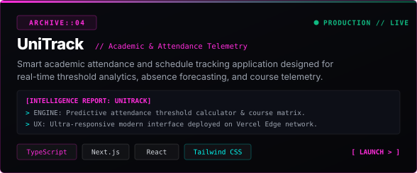
  </a>

  <a href="https://mindpalace-mauve.vercel.app">
    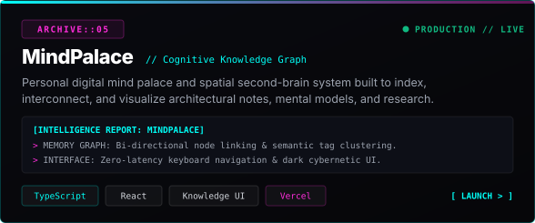
  </a>
  <a href="https://github.com/MrDeha/PDF-Splitter">
    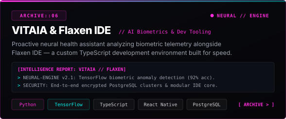
  </a>

 

<!-- ==================== 03 // NEURAL CORE STACK ==================== -->
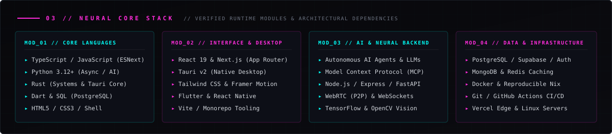

  

  

 

<!-- ==================== NEURAL PULSE & CONTRIBUTION MATRIX ==================== -->

 

<picture>
  <source media="(prefers-color-scheme: dark)" srcset="https://raw.githubusercontent.com/MrDeha/MrDeha/output/deha-sys-snake.svg" />
  <source media="(prefers-color-scheme: light)" srcset="https://raw.githubusercontent.com/MrDeha/MrDeha/output/deha-sys-snake.svg" />
  
</picture>

  

<!-- ==================== 04 // ESTABLISH CONNECTION ==================== -->
<a href="https://dehaclk.com.tr">
  
</a>

 

  <code>DEHA.SYS // SYSTEM INTERFACE v2.6.0</code> &nbsp;•&nbsp;
  <code>DATA PACKETS ENCRYPTED VIA TLS 1.3</code> &nbsp;•&nbsp;
  <a href="https://dehaclk.com.tr"><code>dehaclk.com.tr</code></a>

